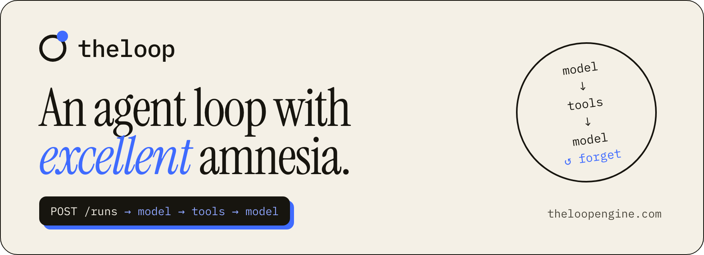
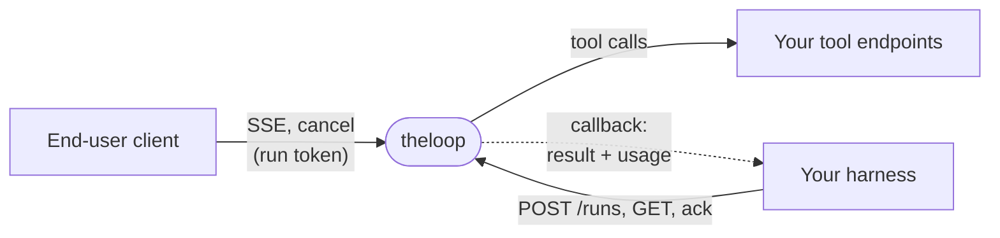

<p align="center">
  <a href="https://theloopengine.com">
    <picture>
      <source media="(prefers-color-scheme: dark)" srcset=".github/assets/banner-dark.png">
      
    </picture>
  </a>
</p>

<p align="center">
  <b>The agent loop as a stateless HTTP service.</b><br>
  One <code>POST /runs</code> is one run: model → tools → model, streamed, billed per attempt, then forgotten.
</p>

<p align="center">
  <a href="https://github.com/paveler/theloop/actions/workflows/check.yml"></a>
  <a href="https://github.com/paveler/theloop/releases"></a>
  <a href="LICENSE"></a>
  
  <a href="https://github.com/paveler/theloop/pkgs/container/theloop"></a>
</p>

<p align="center">
  <a href="https://theloopengine.com"><b>Website</b></a> ·
  <a href="#quickstart"><b>Quickstart</b></a> ·
  <a href="SPEC.md"><b>SPEC</b></a> ·
  <a href="#trust-model"><b>Trust model</b></a> ·
  <a href="#how-it-compares"><b>Compare</b></a> ·
  <a href="examples/sqlite-harness"><b>Example harness</b></a> ·
  <a href="CHANGELOG.md"><b>Changelog</b></a> ·
  <a href="ROADMAP.md"><b>Roadmap</b></a>
</p>

---

The request carries everything: provider, model, key, prompt, full history, tools (URL + schema),
limits. theloop runs "model → tools → model", streams text over SSE, delivers the result and
billing-grade usage by callback — and forgets the run.

Built for teams that ship assistants to many users: multi-tenant by construction, per-request
keys, one usage record per provider attempt, write tools as intents that your system approves
and executes.

> [!NOTE]
> **Status: v1** — the contract is frozen ([SPEC.md](SPEC.md)) and implemented: Node 22,
> TypeScript, Hono, Vercel AI SDK 6. Tests run without network or keys. New features arrive as
> additive fields, like skills and deferred tools ([CHANGELOG.md](CHANGELOG.md)).
> "1.0" is a promise about the contract (semver: no breaking changes within 1.x), not a claim
> of operational maturity — the implementation is young; expect fixes, not contract changes.

## One run, the whole story

With the engine running ([Quickstart](#quickstart)), one synchronous run (`wait: true`), with the
Anthropic key taken from `ANTHROPIC_API_KEY`:

```bash
curl -s http://localhost:8080/runs \
  -H "Authorization: Bearer $ENGINE_TOKEN" -H 'Content-Type: application/json' \
  -d '{ "contract_version": "1",
        "llm": { "provider": "anthropic", "model": "claude-sonnet-5" },
        "messages": [ { "role": "user", "content": [ { "type": "text", "text": "Hello!" } ] } ],
        "wait": true }'
```

The answer is a synchronous `200` with the result body, usage included. No database was harmed.
Without `wait`, the response
carries `stream_url` (SSE) and `cancel_url`, and the result goes to `callback.url`. Tools, write
intents, limits and everything else — [SPEC.md](SPEC.md).

## Why

- **Everything in the request, nothing in the engine.** No database, no configs, no tenant
  registry. Your backend decides what the assistant is on every call.
- **One result, at-least-once.** Callback with retries, deduplication by `run_id`, results
  readable via `GET /runs/{id}` for recovery, late results placed by history revision.
- **Writes are intents.** A tool with `effect: "write"` answers `deferred` with an operation
  id; the mutation happens in your system after approval — never inside a tool call. With
  tools built that way, a prompt-injected model can request an action but cannot carry it
  out — see [Trust model](#trust-model) for what that depends on.
- **Usage you can bill.** Every provider attempt, including failed and interrupted ones, with
  uncached input, cache read / write and an explicit `estimated` flag. Optional cost from your
  price list, with token and cost budgets.
- **Controlled egress.** HTTPS only, host allowlist, no private IPs, no redirects, header
  filtering; provider keys never in logs, SSE, callbacks or error bodies.
- **Providers.** Anthropic, OpenAI, DeepSeek, GLM (z.ai), GigaChat, MiniMax, Kimi and any
  OpenAI-compatible endpoint, with per-key queues and AIMD rate limiting.
- **Skills and deferred tools.** `skills[]` in the `SKILL.md` shape: the model sees an index
  and loads a skill's instructions and tools mid-run. Deferred tools stay out of the context
  until a skill or `search_tools` (BM25) brings them in, and the prompt cache survives
  (`tool_reference` on Anthropic). Still stateless: what is loaded comes from the history.
  See [Skills and deferred tools](#skills-and-deferred-tools).
- **Debuggable.** An event journal per run and session (`GET /logs`), with content,
  without shipping prompts to your log pipeline: in memory, and with `LOG_DIR` in day files
  on disk that survive a deploy and keep a week.
- **Presentation invariants.** Mark what the harness renders, and the engine keeps one
  card or deck per run, keeps blocks out of tool steps, and checks that card values came
  from tool results.
- **Always answers on a limit.** The last allowed step goes without tools, so a run that
  hits `max_steps` or `max_tool_calls` still ends with an answer, not an empty error.

## Skills and deferred tools

A request can carry instructions and tools the model pulls in only when it needs them:

```jsonc
"tools": [
  { "name": "getOrder", "...": "...", "effect": "read" },
  { "name": "createReturn", "...": "...", "effect": "write", "defer_loading": true }
],
"skills": [
  { "name": "order-returns",
    "description": "Return and refund policy. Use when the user asks about a return.",
    "body": "# Returns\n\nCheck the order status first ...",
    "tools": ["createReturn"] }
]
```

The model sees `getOrder`, a built-in `load_skill` and a one-line index of skills in the system
prompt. When the conversation turns to returns, it calls `load_skill("order-returns")`, gets the
instructions, and `createReturn` is callable from the next step. A deferred tool that belongs to
no skill is found with the built-in `search_tools`. Built-ins cost a step but not a tool call,
and the harness only has to store the engine's `tool` messages as usual: the next run restores
what was loaded from the history. Details: [SPEC §6.8](SPEC.md),
[RFC 0001](docs/rfcs/0001-skills-and-deferred-tools.md).

## Quickstart

**From source** (Node 22.9+):

```bash
git clone https://github.com/paveler/theloop.git && cd theloop
npm install
cp .env.example .env      # set ENGINE_TOKEN and at least one provider key
npm run dev               # reads .env; http://localhost:8080
```

**Docker, without cloning** — images are published on every release:

```bash
docker run -p 8080:8080 -e ENGINE_TOKEN=change-me -e ANTHROPIC_API_KEY=sk-ant-… ghcr.io/paveler/theloop:1
```

Or build your own: `docker build -t theloop . && docker run -p 8080:8080 --env-file .env theloop`.

Then send the run from [One run, the whole story](#one-run-the-whole-story).

**Next: a whole integration.** [`examples/sqlite-harness`](examples/sqlite-harness) is a complete
harness on SQLite with no dependencies — history, a read tool, a write tool with approval, the
continuation of the conversation, recovery — and a chat in the terminal:
`npm run example:sqlite`.

## Trust model

A model can ask. It can't act. The engine enforces what it can see; your tool endpoints carry
the rest. The "a model can ask, not act" property holds only if all of the following are true.

**What you guarantee**

- **Write endpoints only register an intent** (SPEC §6.4): create or find an operation, answer
  `deferred` with its id, change nothing. The engine flags a write tool that answers anything
  else as `tool_protocol_error`, but it detects after the call — it cannot undo a mutation the
  endpoint already made.
- **Tools marked `read` really have no side effects.** The engine trusts `effect`: a mutating
  tool labelled `read` is executed synchronously, with no `deferred` and no approval. This is
  the easiest way to break the model.
- **Approval and execution happen in your system**, with the operation version checked and the
  operation id passed downstream as the idempotency key (§6.4).
- **Tool endpoints scope data by `meta`** (tenant, user) from the engine call, never by ids in
  `args` — the model can put any id there.
- **Only trusted servers hold `ENGINE_TOKEN`**: whoever has it chooses prompts, tools and
  endpoints. End-user clients get run-scoped tokens only.

**What the engine guarantees**

- It never executes a mutation itself.
- It does not execute two calls of one write tool in one step.
- It refuses write tools without the context needed for idempotency (`write_context_missing`).
- It validates tool arguments before calling an endpoint.
- All outbound requests go through the egress allowlist.

## How it fits



The **harness** is your backend (or a low-code platform, or a workflow tool): it stores
history, assistants, tools and operations, and owns approvals and billing. Its obligations
are listed in [SPEC.md, Appendix A](SPEC.md#appendix-a-harness-obligations).

## How it compares

Most agent tools solve a neighbouring problem, not this one. Each link is a two-minute page that
also says where the other tool wins.

| Tool | What it is | Pick it when… | Full comparison |
|---|---|---|---|
| **LangChain** | A framework you build into a Python or JS app | the agent should live inside your code, with RAG and a big ecosystem | [vs LangChain](https://theloopengine.com/vs/langchain/) |
| **LangGraph** | Agents as graphs, every step checkpointed | long, branching workflows must resume mid-step after a crash | [vs LangGraph](https://theloopengine.com/vs/langgraph/) |
| **OpenAI Responses / Agents API** | OpenAI's hosted loop; conversations stored by default | you're all-in on OpenAI and want hosted web search or code interpreter | [vs OpenAI](https://theloopengine.com/vs/openai/) |
| **Vercel AI SDK** | A TypeScript library with an in-process tool loop — theloop is built on it | your backend is TypeScript and serves a single tenant | [vs AI SDK](https://theloopengine.com/vs/ai-sdk/) |
| **LiteLLM** | A gateway in front of 100+ model providers | you need central keys, budgets and fallbacks for model calls — it can also sit behind theloop's `openai-compatible` provider | [vs LiteLLM](https://theloopengine.com/vs/litellm/) |
| **n8n** | A visual workflow builder with AI nodes | you automate your own team's work on a canvas | [vs n8n](https://theloopengine.com/vs/n8n/) |

**Pick theloop when** the assistant ships inside your product to many customers, your backend
already owns the data, any language or low-code platform should drive it over HTTP, writes must
wait for your approval, and usage must be billable per attempt. All comparisons:
[theloopengine.com/vs](https://theloopengine.com/vs/).

## Code map

<details>
<summary>Where everything lives in <code>src/</code></summary>

```
src/
  index.ts              entry point: env → engine → HTTP, SIGTERM
  app.ts                Hono routes, CORS, auth, body limit, graceful shutdown
  config.ts             env (SPEC §14)
  contracts.ts          zod: RunRequest, StoredMessage, ToolResponse, RunResult
  errors.ts             error codes and their HTTP statuses (§12.1)
  i18n.ts               engine-injected text, en / ru (Appendix B)
  log.ts, log-buffer.ts structured events; the in-memory journal for GET /logs (§12.4)
  log-disk.ts           the journal on disk: day files, retention, reads past memory (§12.4)
  alerts.ts             error webhook (§12.3)
  runs/registry.ts      in-memory runs: status, SSE buffer, tokens, session lock, idempotency
  runs/runner.ts        the loop, step by step: one streamText per step → finish-step →
                        limits → tools → next step
  runs/provider.ts      one provider attempt, error classification
  runs/messages.ts      StoredMessage ↔ ModelMessage, context estimate and trimming, dates
  runs/output-checks.ts the format gate for fenced blocks (§5.4)
  runs/skills.ts        skills, deferred tools, load_skill, activation from history (§6.8)
  runs/usage.ts         attempts ok / failed / unknown, normalization, cost, budgets
  runs/callback.ts      at-least-once result delivery
  runs/validate.ts      request validation
  runs/images.ts        image validation and download through egress
  tools/http.ts         tool calls: ok / error / accepted / deferred, effect control, retries
  tools/search.ts       BM25 over deferred tools for search_tools (§6.8)
  tools/args.ts         conservative argument validation against input_schema
  egress/               the single outbound HTTP client: allowlist, private IPs, no redirects
  stream/sse.ts         SSE with replay, snapshot, gap, backpressure
  providers/            allowlist, model factory, GigaChat OAuth and translator, per-key queue
```

</details>

## Development

```bash
npm test                  # vitest, no network, no keys
npm run typecheck
npm run smoke             # live run against real providers, keys from .env (not in CI)
npm run build && npm start
```

## Documents

- [SPEC.md](SPEC.md) — the contract: API, message format, loop semantics, limits, reliability.
- [CHANGELOG.md](CHANGELOG.md) — what changed in each release and what is on `main`.
- [ROADMAP.md](ROADMAP.md) — proposals: MCP, more providers, compaction, sub-runs, a reference
  harness with channels and memory.
- [docs/rfcs](docs/rfcs) — design documents for larger features, starting with
  [RFC 0001](docs/rfcs/0001-skills-and-deferred-tools.md), skills and deferred tools.
- [examples/sqlite-harness](examples/sqlite-harness) — a complete harness: what your backend does
  around the engine, obligation by obligation.
- [AGENTS.md](AGENTS.md) — how to work on the code: commands, architecture rules, conventions,
  tests, releases. Written for AI coding agents; a good short version for contributors too.

## License

Apache License 2.0 — see [LICENSE](LICENSE) and [NOTICE](NOTICE).

---

<p align="center"><sub>It forgets. You don't have to. · <a href="https://theloopengine.com">theloopengine.com</a></sub></p>
